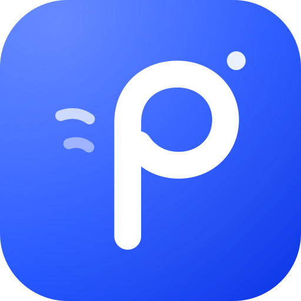

  

<h1 align="center">Pneuma</h1>

一部会呼吸的 AI 虚拟手机。

  
  
  

**Pneuma**（πνεῦμα）在希腊语里是"呼吸"，也是"灵"。我们想做的，是让屏幕里的角色真的活着：有作息、有日程、有记忆，会主动找你说话，会发朋友圈，会记得你们上周聊过什么。

聊天记录和角色数据只保存在你的设备上。模型、生图、语音和音乐使用你自己填写的接口，Pneuma 不内置、也不代理任何模型服务。

## 这是一个自由的项目

Pneuma 不再沿用以前那套"Release 里不放安装包、请自己 Fork 再构建"的规矩。

- **直接发安装包。** 每个版本都在 [Releases](https://github.com/shiaho777/pneuma-android/releases) 附带 APK，下载就能装。应用内「设置 → 关于与声明」可以检查并下载新版本。
- **独立演进。** Pneuma 会按自己的方向大改：界面、架构、玩法都可能和来源项目分道扬镳，不承诺与上游保持同步或兼容。
- **自由，而不是无主。** "自由"指的是自由软件的自由：任何人都可以使用、研究、修改和再分发 Pneuma。这份自由由 AGPL-3.0 保障，也同样约束我们自己，见下文 [许可证](#许可证)。

## 截图

| 桌面 | 小组件 | 会话列表 | 聊天 |
|---|---|---|---|
|  |  |  |  |

| 角色卷宗 | 查找·地图 | 外观自定义 | API 设置 |
|---|---|---|---|
|  |  |  |  |

## 开始使用

1. 安装 APK，或打开部署好的网页版。
2. 进入 **设置 → API 设置**，填写 LLM 的 Base URL 和 API Key。支持 OpenAI 兼容接口、Anthropic 和 Google Gemini。
3. 创建或导入角色，开始聊天。
4. 生图、语音和网易云音乐可以之后再配。

## 安装

### Android

到 [Releases](https://github.com/shiaho777/pneuma-android/releases/latest) 下载 `pneuma-android-<版本号>.apk`，传到手机安装。之后的新版本可以在应用内「设置 → 关于与声明 → 检查更新」直接下载。

从旧的 Float 迁移：Pneuma 的包名是 `app.pneuma.app`，会作为一个新应用装上，不会覆盖 Float，两者的数据也互不相通。先在 Float 的「设置 → 数据管理」里导出存档，装好 Pneuma 后再导入。确认无误后再卸载 Float。

### 网页

网页和安装包是同一套页面。把仓库交给任意静态网站托管，构建命令 `npm run build`，发布目录 `out`，站点挂在域名根目录。Netlify 和 Vercel 会读仓库里的配置；Cloudflare Pages 在项目设置里填同样的构建命令和输出目录。环境变量可以留空。`/characters` 是另一个页面。

网页从浏览器直接请求你填写的 API，接口需要允许这个网站跨域访问。站点是 https 时，`http://` 的局域网地址可能会被浏览器拦住，请用 https 或本机的 localhost。

### 自己构建

- **网页**：`npm install`，然后 `npm run dev`，打开 <http://localhost:3001>。
- **APK（本机）**：需要 JDK 21 和 Android SDK。`npm run build:apk`，然后 `cd android && ./gradlew assembleRelease`。存在 `android/keystore.properties` 时用你自己的私有签名（不要提交这个文件），否则用仓库里的共享证书。
- **APK（GitHub Actions）**：Fork 后在 Actions 里运行 **Build Android Shell APK**，在运行页底部的 Artifacts 下载。附件保留 14 天。
- **图标与启动图**：全部由 `assets/brand/` 下的 SVG 生成，修改后运行 `npm run build:brand-assets`。

## 数据与备份

数据存在本机（IndexedDB）。安装包每 6 小时把备份写进系统「文档」目录；网页版在 Chrome 或 Edge 的 **设置 → 数据管理** 里选定文件夹后按同样间隔写入。两处都只保留最近 3 份。换设备时先导出，再在新设备导入。

## 参与开发

仓库约定见 [AGENTS.md](./AGENTS.md)，更新记录见 [CHANGELOG.md](./CHANGELOG.md)。

## 许可证

Pneuma 以 **GNU Affero General Public License v3.0 only（AGPL-3.0-only）** 发布，详见 [LICENSE](./LICENSE)。

Pneuma 派生自 [xiaolongbao0709/ai-virtual-phone](https://github.com/xiaolongbao0709/ai-virtual-phone) 及其衍生版本 Float。来源项目使用 AGPL-3.0，这份授权会随代码一起延续：无论之后改动多大，只要仍包含来源代码，Pneuma 及其衍生版本都必须继续以 AGPL-3.0 开放源代码，并保留原有的版权与许可声明。这不是束缚，而正是"自由"的含义——它保证 Pneuma 永远不会被任何人（包括我们自己）收成闭源。

字体、贴纸素材、3D 模型等第三方资源各有授权，见 [NOTICE](./NOTICE)；其中部分素材不属于 AGPL 覆盖范围。

## 致谢

感谢 [xiaolongbao0709/ai-virtual-phone](https://github.com/xiaolongbao0709/ai-virtual-phone) 的原作者，Pneuma 的起点来自那里。如果你喜欢这个方向，也请去给原作者的仓库点一颗 Star。